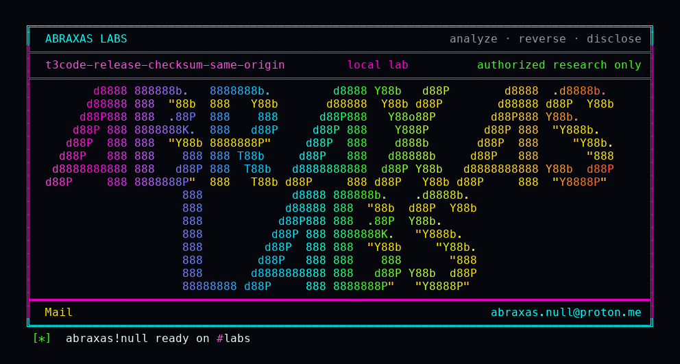

<p align="center">
  
</p>

# t3code-release-checksum-same-origin

The updater checks a SHA-256 file that lives next to the download. Steal the download host and you steal the checksum too. There is no signature on that path. Accidental corruption still fails. A swapped pair from the same origin installs.

**Class:** Supply chain
**Reach:** Supply chain (whoever controls `releaseBaseUrl`)

**T3 Code** `61c3794c` - Ping

| | |
|---|---|
| ID | no CVE yet |
| Class | **Supply chain** |
| Reach | **Supply chain** (compromised release host, CDN, or DNS/TLS on that origin) |
| CWE | [CWE-345](https://cwe.mitre.org/data/definitions/345.html) / [CWE-494](https://cwe.mitre.org/data/definitions/494.html) |
| CVSS | **Medium: 6.8** `CVSS:3.1/AV:N/AC:H/PR:N/UI:R/S:U/C:H/I:H/A:H` |
| Product | [T3 Code](https://github.com/pingdotgg/t3code) |
| Affected | **61c3794c32b0eeebfac09add43e403618c65d2d7** |
| Auth | none on the victim once the publisher is owned; the victim runs an install or update |
| License | [GNU Affero GPL v3.0](LICENSE) |
| Lab | loopback publisher `127.0.0.1:18192`; `tar` mocked so archive bytes are never executed |

## What an attacker can do

Needs control of the origin that serves both `SHA256SUMS` and the archive (`releaseBaseUrl` / GitHub Releases for that build). Does not need a T3 account on the victim.

| Privilege | Method / sink | Recon / integrity / availability | Lab-proven or inferred |
|---|---|---|---|
| Publish matching archive + checksum from one origin | `ensurePinnedRuntimeInstalled` fetches `${baseUrl}/SHA256SUMS` then `${baseUrl}/${fileName}`, SHA-256 compare | Integrity (accepted install) | Lab-proven. checksum-pass=1, witness `t3f02s9m4` in both files |
| Drive self-update / boot-service through the same helper | `selfUpdate.ts`, `bootService.ts` pass `releaseBaseUrl` | Integrity | Source. Lab called the helper directly |
| Execute the installed binary after extract | `tar -xf` then run `t3` | Integrity / availability | Inferred. Lab mocked `tar` and did not execute bytes |
| Negative control: mismatched checksum | same helper, zeros in SHA256SUMS | n/a | Lab-proven. step `verifying the t3 release archive checksum` |

**Stays closed on this leftover**

| Axis | Method / sink | Why it is closed |
|---|---|---|
| Integrity | Accidental bit-flip in transit | SHA-256 mismatch refuses extract |
| Integrity | Unsigned extra origin | Lab used one base URL; a second origin is never consulted because none exists |
| Integrity | This lab executing attacker bytes | `tar` mocked; extracted-binary-executed=0 |

signature-check=0 on the download+digest block and the self-update / boot-service callers (no minisign, cosign, GPG, or sigstore).

## How I found it

`pinnedRuntime.ts` builds both URLs from `cliReleaseDownloadBaseUrl`. In-tree tests already lock same-origin checksum pass and mismatch fail. They do not require a signature.

Wrong turns: treating a checksum as a publisher authenticator.

## Lab

```bash
python3 t3code-release-checksum-same-origin-Abraxas-Labs.py
```

or:

```bash
cd lab
./run.sh
```

Loopback HTTP publisher on `127.0.0.1:18192`. Production `ensurePinnedRuntimeInstalled` uses Effect fetch against that origin. Matching pair installs (mocked extract). Mismatched pair stops at verify.

```text
IOC loopback-bound=127.0.0.1:18192
IOC same-origin=1
IOC checksum-pass=1
IOC checksum-fail=1
IOC signature-check=0
IOC tar-mocked=1
IOC extracted-binary-executed=0
SUCCESS T3-F02-CHECKSUM t3f02s9m4
```

## The fix

Sign the checksum manifest (minisign, cosign, or GPG) and embed the public key in the binary. Verify the signature before parsing SHA256SUMS. Pin the release origin to an immutable signed reference.

## References

- [github.com/pingdotgg/t3code](https://github.com/pingdotgg/t3code) `61c3794c32b0eeebfac09add43e403618c65d2d7`
- [`pinnedRuntime.ts` download+digest](https://github.com/pingdotgg/t3code/blob/61c3794c32b0eeebfac09add43e403618c65d2d7/apps/server/src/cloud/pinnedRuntime.ts)
- [CWE-345](https://cwe.mitre.org/data/definitions/345.html) · [CWE-494](https://cwe.mitre.org/data/definitions/494.html)

## License

GNU Affero GPL v3.0. See [LICENSE](LICENSE). Loopback lab only. No warranty.

Abraxas Labs
abraxas.null@proton.me

